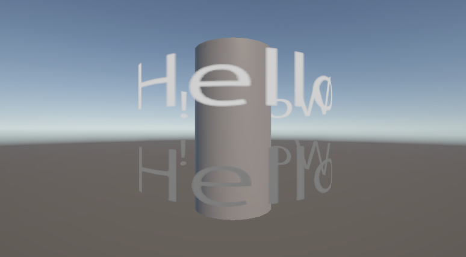
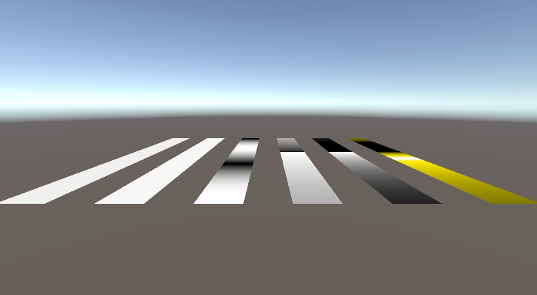
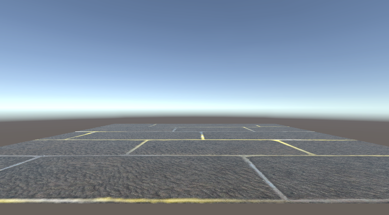
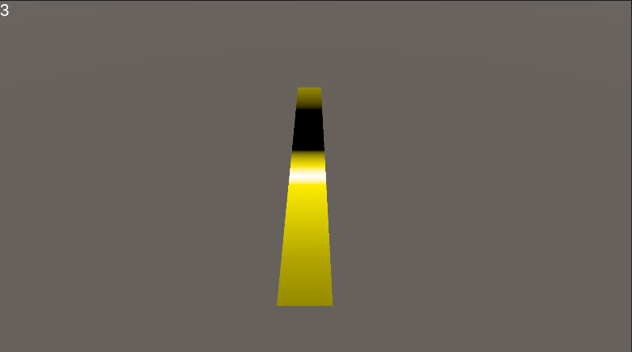

# はじめに
プログラムワークショップIVの管理用です

# 結果画像

![結果]

![結果]

![結果]

![結果]

- 工夫した点：左クリックしたらShaderが動いて、1周したら止まるようにしました。

※左上のテキストは左クリックしたことを分かりやすく表示するものなので今回の処理には何も関係がありません。

# 進め方

- 本リポジトリをforkしてください
- fork先のリポジトリを更新してください
- Unityのプロジェクトをsrc内で進めてください
- 結果を画面キャプチャして、画像としてリポジトリに追加して、上記のリンクから見られるようにしてください
- 完成したら本リポジトリのmainブランチにpull requestを投げてください
